# MATLAB Communication Systems — Multi-Carrier Signal Processing

A MATLAB-based communication system developed to investigate multi-carrier modulation, signal transmission through additive white Gaussian noise (AWGN), and accurate message reconstruction under spectral amplitude constraints.

The main system uses **five-carrier double-sideband suppressed-carrier (DSB-SC) modulation**, coherent demodulation, FIR filtering, and weighted signal reconstruction. Additional standalone experiments explore 8-PSK modulation, Fourier spectrum replication, and digital filter frequency responses.

The original design was developed for the **ELEC1323 — Introduction to Signals, Control and Communications** coursework at the University of Southampton. The repository has subsequently been refined with a standalone simulation driver, additional experiments, and automated figure exports.

## Overview

- Five-carrier analogue modulation at 6, 8, 10, 12 and 14 Hz.
- FFT-based spectral amplitude scaling within a specified frequency band.
- Simulation of additive white Gaussian noise (AWGN).
- Coherent demodulation, FIR low-pass filtering and weighted signal reconstruction.
- Reconstruction SNR evaluation and time- and frequency-domain visualisation.
- Additional 8-PSK, sampling theory and FIR filter comparison experiments.

<p align="center">
  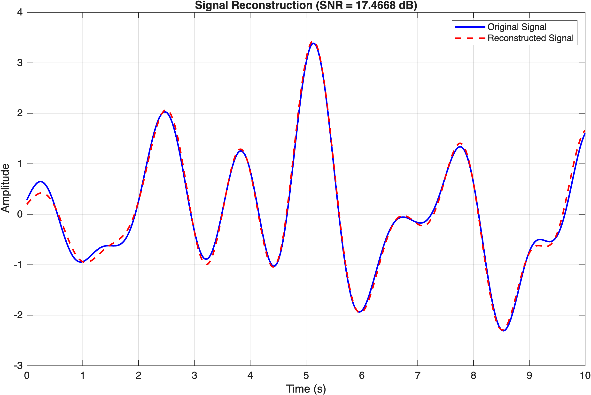
</p>
<p align="center"><em>Original and reconstructed waveforms from the standalone MATLAB simulation.</em></p>

## System Architecture

The simulation generates a band-limited message, modulates it onto five carriers, adds AWGN, and reconstructs the message using coherent demodulation and weighted combining.

<p align="center">
  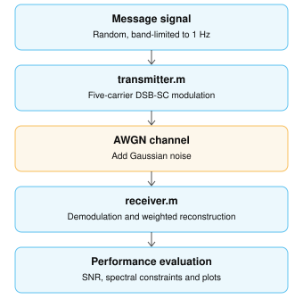
</p>

### Transmitter and Receiver Design

<p align="center">
  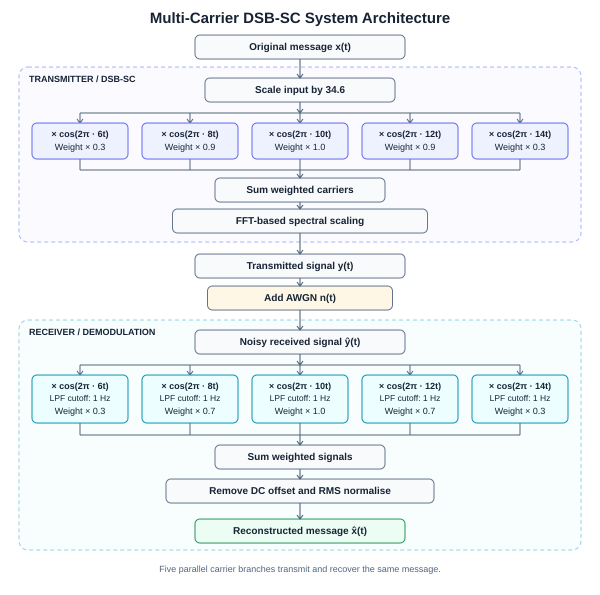
</p>

Each transmitter branch multiplies the entire message by a cosine at the specified carrier frequency and applies its weight. Each receiver branch multiplies the received signal by the corresponding cosine, applies a **1.0 Hz low-pass FIR filter**, and applies its receiver weight.

### 1. Multi-Carrier DSB-SC Modulation

The transmitter modulates the same message onto five carrier frequencies. Their weighted sum is scaled using its FFT amplitude spectrum to respect the transmission limits.

| Carrier frequency | Transmitter weight | Receiver weight |
| --- | ---: | ---: |
| 6 Hz | 0.3 | 0.3 |
| 8 Hz | 0.9 | 0.7 |
| 10 Hz | 1.0 | 1.0 |
| 12 Hz | 0.9 | 0.7 |
| 14 Hz | 0.3 | 0.3 |

The modulation can be represented as:

$$
y(t)=\alpha\,34.6\,x(t)\sum_{i=1}^{5}a_i\cos(2\pi f_i t)
$$

where $a_i$ is the transmitter weight, $f_i$ is the carrier frequency, and $\alpha$ is the final spectrum-dependent scaling factor. The initial amplification is retained from the original implementation; the final scaling determines the transmitted amplitude.

### 2. Spectral Constraints

| Frequency range (single-sided amplitude spectrum) | Maximum amplitude |
| --- | ---: |
| 5–15 Hz, inclusive | 5.0 |
| Outside 5–15 Hz | 0.3 |

The transmitter calculates the FFT amplitude spectrum and selects the smaller of the in-band and out-of-band scaling factors, targeting amplitudes of 4.9999 and 0.2999 respectively. The simulation driver checks the resulting single-sided spectrum numerically.

### 3. AWGN Channel

The transmitted signal is corrupted by additive white Gaussian noise:

$$
\hat{y}(t)=y(t)+n(t)
$$

The standalone simulation uses reproducible Gaussian noise with a standard deviation of 10. This is a software channel model rather than a physical RF link.

### 4. Signal Reconstruction

The receiver demodulates all five carrier branches and removes their high-frequency components using 1.0 Hz low-pass filters. The filtered branches are combined using the receiver weights, followed by DC removal and RMS normalisation.

The design retransmits the same analogue message across carriers; it does not multiplex five independent data streams.

## Simulation Results

### Simulation Parameters

| Parameter | Value |
| --- | --- |
| Sampling frequency | 100 Hz |
| Signal duration | 100 s |
| Number of samples | 10,000 |
| Message bandwidth | 1 Hz |
| Carrier frequencies | 6, 8, 10, 12, 14 Hz |
| AWGN standard deviation | 10 |
| Receiver LPF cutoff | 1.0 Hz |
| Random seed | 42 |

The following plots are actual MATLAB outputs generated from the standalone simulation. Waveform plots display the first 10 seconds; spectra and SNR calculations use the full simulated signal.

### Original Message Signal

The original signal is randomly generated, band-limited to 1 Hz, and normalised to unit RMS amplitude.

<p align="center">
  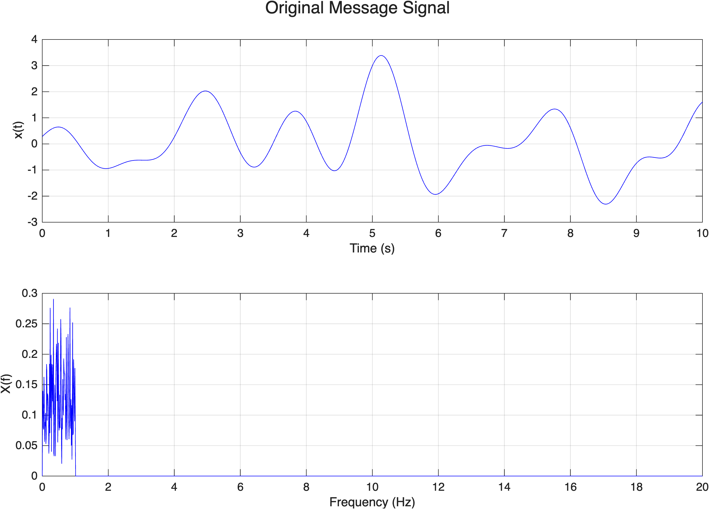
</p>

### Transmitted Signal

The five-carrier DSB-SC signal occupies the intended 5–15 Hz band. The red line represents the specified spectral amplitude limits.

<p align="center">
  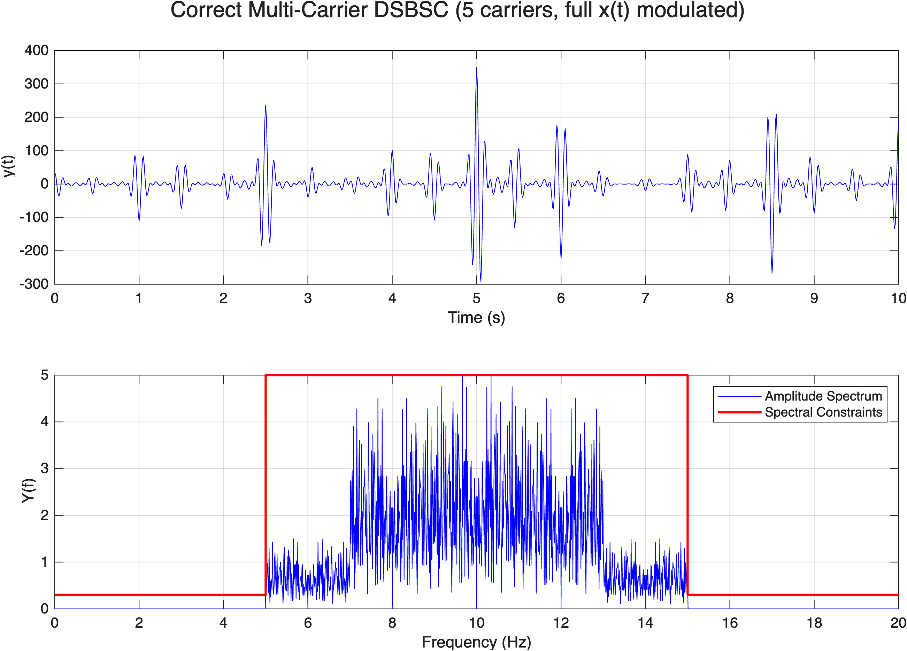
</p>

### Received Signal with Noise

AWGN introduces random fluctuations in the transmitted waveform and its spectrum.

<p align="center">
  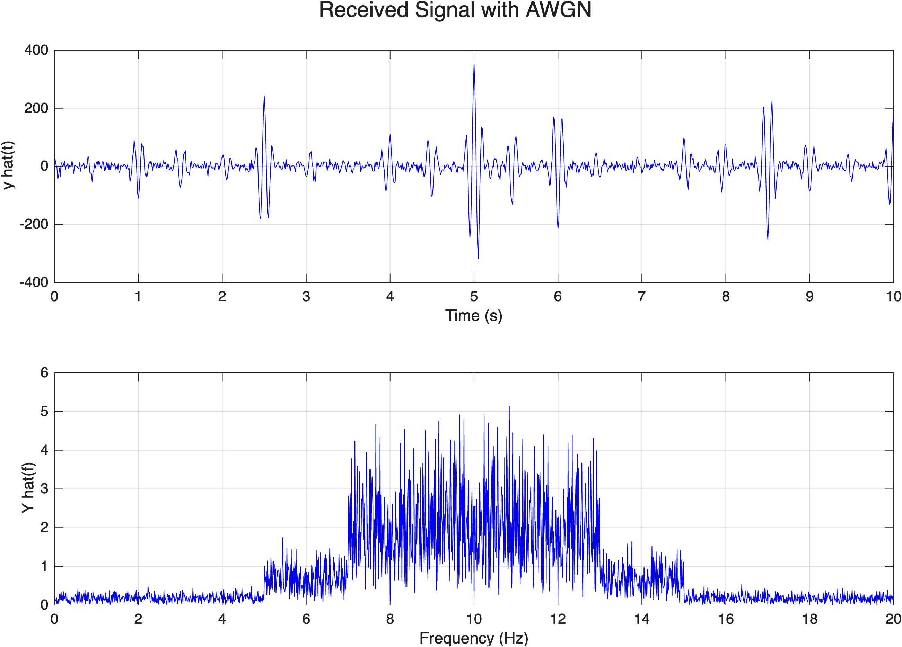
</p>

### Reconstructed Signal

Coherent demodulation, filtering and weighted combining recover the original low-frequency message.

<p align="center">
  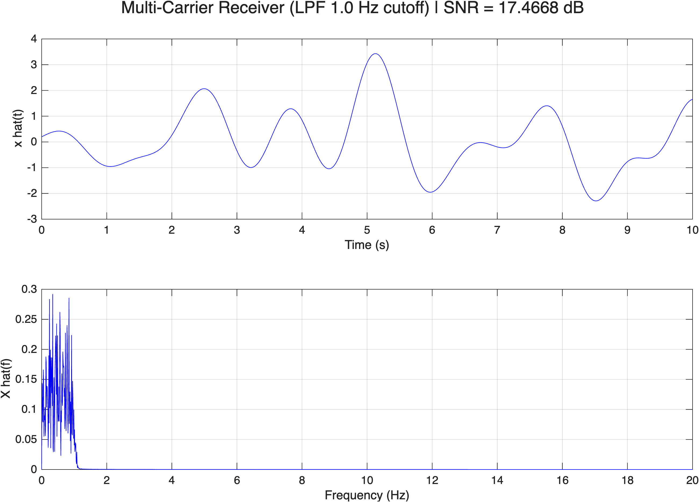
</p>

### Signal-to-Noise Ratio (SNR)

Reconstruction performance is evaluated by comparing the original message power with the mean squared reconstruction error:

$$
\mathrm{SNR}_{\mathrm{dB}}=10\log_{10}\left(\frac{\mathrm{mean}(x^2)}{\mathrm{mean}((x-\hat{x})^2)}\right)
$$

| Simulation | Reconstruction SNR |
| --- | ---: |
| Original coursework simulation (May 2025) | 18.4653 dB |
| Standalone MATLAB simulation | 17.4668 dB |

The standalone simulation produces a close visual match between the original and reconstructed waveforms, as shown in the preview above. The two recorded SNR values were obtained under different simulation conditions and should not be treated as a controlled before-and-after performance comparison.

## Digital FIR Filters

Four filtering functions are included, covering centred FIR filtering, cascaded band-pass filtering, and causal high-order FIR filtering.

### Filter Types

| Filter | Implementation | Conceptual frequency response |
| --- | --- | --- |
| Low-pass | Adaptive-order FIR using `fir1` and `filter2`; used by the receiver | 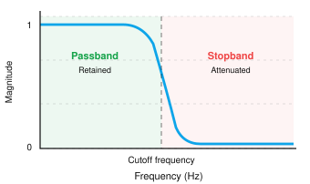 |
| High-pass | Adaptive-order FIR using `fir1` and `filter2` | 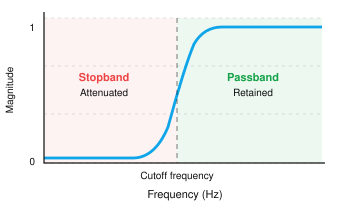 |
| Band-pass | Cascaded low-pass and high-pass filters | 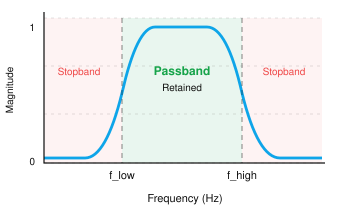 |
| High-order low-pass | Fixed 1,000th-order FIR using `fir1` and `filter` | 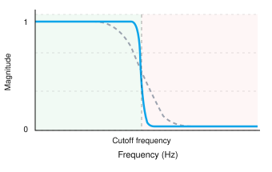 |

*The SVGs are explanatory sketches, not measured responses. In the high-order low-pass sketch, the solid blue curve represents a sharper transition and the dashed grey curve represents a wider transition.*

### Band-Pass Filter Architecture

The band-pass filter first removes components above the upper cutoff, then removes components below the lower cutoff.

<p align="center">
  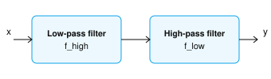
</p>

### Filter Frequency Response Comparison

The filter comparison experiment applies each filtering function to a unit impulse, then uses the FFT to calculate its magnitude response. The resulting responses are shown in linear magnitude and decibels.

| Filter | Experiment cutoff |
| --- | --- |
| Low-pass | 5 Hz |
| High-pass | 5 Hz |
| Band-pass | 5–15 Hz |
| High-order low-pass | 5 Hz |

<p align="center">
  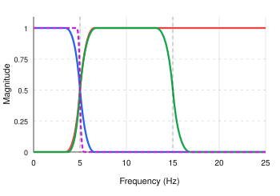
</p>
<p align="center"><em>Conceptual response comparison: blue — low-pass; red — high-pass; green — band-pass; dashed magenta — high-order low-pass.</em></p>

<p align="center">
  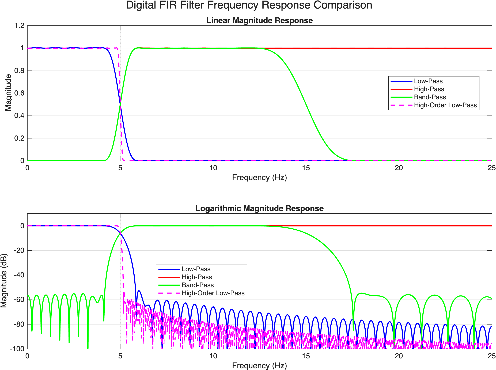
</p>
<p align="center"><em>Actual MATLAB impulse-response-based comparison.</em></p>

The fixed high-order filter has a narrower transition at the selected 5 Hz cutoff and 100 Hz sampling rate. Its causal implementation introduces a group delay of 500 samples. The adaptive-order filters use centred filtering, so their alignment differs from the causal implementation. Relative sharpness depends on the selected parameters.

## Additional Signal Processing Experiments

### 8-PSK Modulation and Spectral Analysis

`psk8_spectrum.m` generates an 8-phase shift keying (8-PSK) waveform by assigning random symbols to eight equally spaced carrier phases. It then calculates and plots the normalised amplitude spectrum using FFT.

| Parameter | Value |
| --- | --- |
| Modulation order | 8 |
| Carrier frequency | 100 Hz |
| Sampling frequency | 10,000 Hz |
| Symbol rate | 20 symbols/s |
| Number of symbols | 50 |
| Bits represented per symbol | 3 |

<p align="center">
  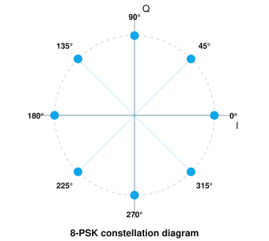
</p>
<p align="center"><em>Conceptual 8-PSK constellation.</em></p>

<p align="center">
  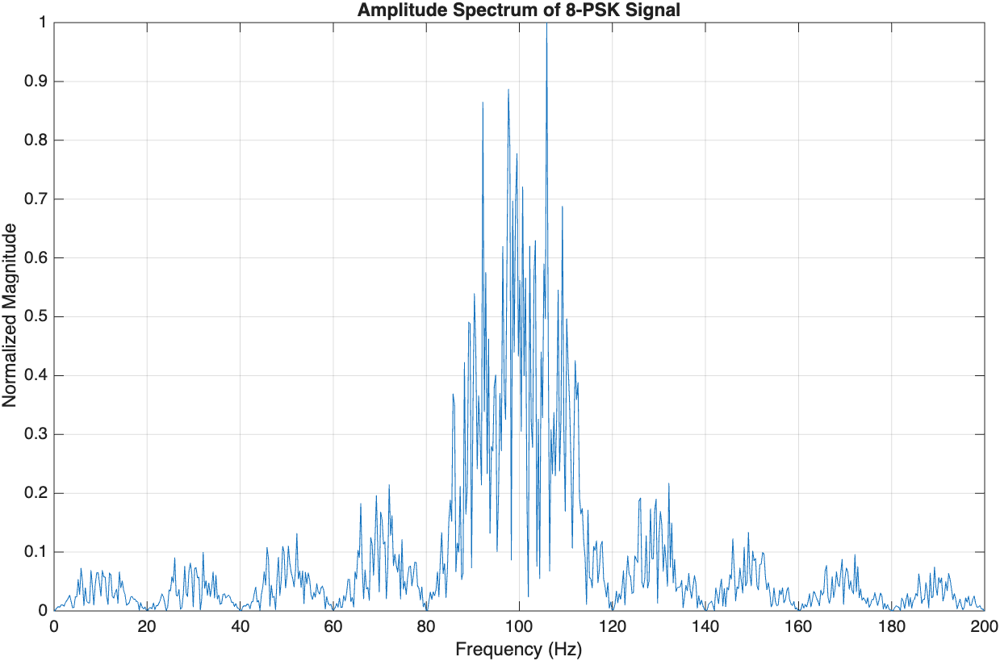
</p>
<p align="center"><em>MATLAB-generated 8-PSK amplitude spectrum.</em></p>

The experiment is independent of the main analogue DSB-SC system. It uses rectangular symbol intervals without pulse shaping and does not implement a digital receiver or bit-error-rate evaluation. The random symbol sequence may change between runs.

### Sampling and Fourier Spectrum Replication

`sampling_spectrum.m` illustrates how sampling produces shifted copies of a continuous-time signal spectrum at multiples of the sampling angular frequency.

$$
X_s(\omega)=\frac{1}{T_s}\sum_{k=-\infty}^{\infty}X(\omega-k\omega_s)
$$

The script plots a finite set of spectral replicas using relative amplitudes rather than the absolute impulse-train scaling factor.

| Parameter | Value |
| --- | --- |
| Sampling angular frequency | 4,000 rad/s |
| Original positive angular frequencies | 2,000π, 5,000π, 7,000π rad/s |
| Relative amplitudes | 1, 0.05, 0.05 |
| Replica indices | −2 to 2 |

<p align="center">
  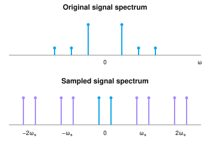
</p>
<p align="center"><em>Simplified conceptual illustration of spectral replication; not an exact reproduction of all components in the experiment.</em></p>

<p align="center">
  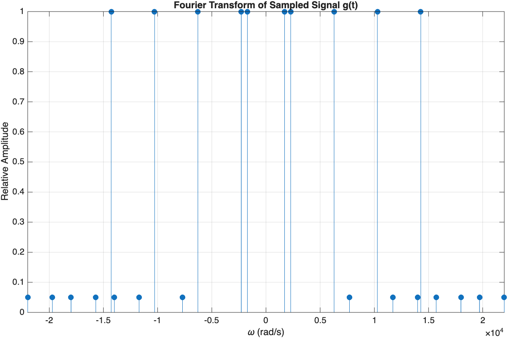
</p>
<p align="center"><em>Actual sampled signal Fourier spectrum for the configured finite replica range.</em></p>

The script illustrates spectral replication and aliasing. Its sampling angular frequency is in rad/s, not Hz, and is lower than twice the highest original angular frequency. It is not intended to demonstrate alias-free reconstruction.

## Repository Structure

```text
MATLAB-Communication-Systems/
├── main.m
├── transmitter.m
├── receiver.m
├── filters/
│   ├── low_pass_filter.m
│   ├── high_pass_filter.m
│   ├── band_pass_filter.m
│   └── sharp_low_pass_filter.m
├── experiments/
│   ├── psk8_spectrum.m
│   ├── sampling_spectrum.m
│   └── filter_comparison.m
├── images/
│   ├── generated/
│   │   ├── original-signal.png
│   │   ├── transmitted-signal.png
│   │   ├── noisy-signal.png
│   │   ├── reconstructed-signal.png
│   │   ├── signal-comparison.png
│   │   ├── psk8-spectrum.png
│   │   ├── sampling-spectrum.png
│   │   └── filter-comparison.png
│   └── explanation/
│       ├── workflow.svg
│       ├── low-pass-filter.svg
│       ├── high-pass-filter.svg
│       ├── band-pass-filter.svg
│       ├── sharp-low-pass-filter.svg
│       ├── band-pass-architecture.svg
│       ├── filter-comparison.svg
│       ├── 8-psk-constellation-diagram.svg
│       └── sampled-signal-spectrum.svg
├── .gitignore
└── README.md
```

## Requirements

- MATLAB (the standalone simulation was run using MATLAB R2026b on macOS).
- Signal Processing Toolbox for FIR filter design using `fir1`.
- A MATLAB version supporting local functions in scripts, `sgtitle`, `xline` and `exportgraphics` (R2020a or later for these plotting APIs).

Simulink, Communications Toolbox and DSP System Toolbox are not required for the current MATLAB scripts.

## How to Run

Open the repository root as the current folder in MATLAB.

### Main communication system

```matlab
main
```

This runs the communication simulation, prints the reconstruction SNR and spectral constraint check, and exports five figures to `images/generated/`.

### Additional experiments

```matlab
run('experiments/psk8_spectrum.m')
exportgraphics(gcf, 'images/generated/psk8-spectrum.png', 'Resolution', 300);

run('experiments/sampling_spectrum.m')
exportgraphics(gcf, 'images/generated/sampling-spectrum.png', 'Resolution', 300);

run('experiments/filter_comparison.m')
```

The filter comparison automatically exports `filter-comparison.png`. The two other experiments require the export commands shown above. Run each script and its export command before moving on to the next experiment, as the scripts close existing figure windows. Run `main` first, or create `images/generated/` before exporting if it does not already exist.

The transmitter, receiver and individual filter files are functions called by the scripts, rather than standalone entry points.

## Technical Notes and Limitations

- The simulation assumes evenly spaced time samples and a shared, synchronised carrier reference at the transmitter and receiver.
- The main design is an analogue multi-carrier system; 8-PSK is a separate digital modulation experiment.
- FFT-based spectral scaling and verification concern discrete spectrum samples in the simulation; they are not certification of a physical transmitter.
- The centred FIR filter implementation is intended for offline signal processing and can introduce edge effects.
- The standalone driver uses independently selected message and noise parameters, so it does not exactly reproduce the original university test environment.
- SVG explanations are illustrative. PNG files in `images/generated/` show the actual MATLAB outputs.

## Acknowledgements

The original transmitter and receiver design was developed for the **ELEC1323 — Introduction to Signals, Control and Communications** module at the University of Southampton. The low-pass and high-pass filter helpers originated from university coursework materials. Subsequent documentation, code refinements and the standalone simulation driver were prepared with AI assistance.

University-supplied materials and assessed coursework remain subject to applicable copyright and academic-integrity requirements. Public redistribution of code, diagrams and results should only take place with appropriate permission.
